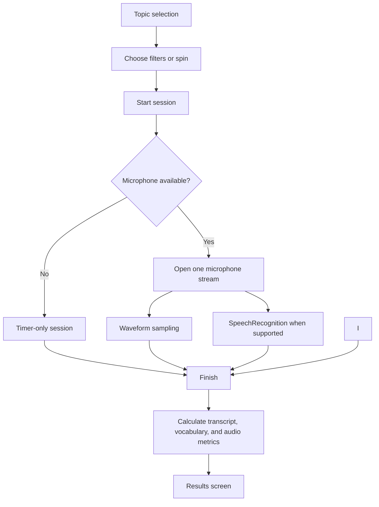

# Vocab Speak — Project Guide

> A guided speaking-practice app that gives you a topic, a few rescue words, and a useful picture of how your speaking session went.

This guide describes the **current code in this repository**. It is intended for someone who wants to run the app, understand how its features work, change the UI, or safely extend the project.

---

## Contents

- [What the app does](#what-the-app-does)
- [Run it locally](#run-it-locally)
- [A complete session, from click to results](#a-complete-session-from-click-to-results)
- [How the analysis works](#how-the-analysis-works)
- [Browser APIs, privacy, and external services](#browser-apis-privacy-and-external-services)
- [Project map](#project-map)
- [Local storage and session data](#local-storage-and-session-data)
- [Visual design](#visual-design)
- [Build and deploy on Vercel](#build-and-deploy-on-vercel)
- [Current limitations and implementation notes](#current-limitations-and-implementation-notes)
- [Good places to extend the app](#good-places-to-extend-the-app)

---

## What the app does

Vocab Speak helps a person practise speaking continuously in English without preparing a script first. It is a single-page React app with three screens:

1. **Choose a topic.** Filter prompts by category and difficulty, spin for another topic, or add a personal prompt.
2. **Speak.** A timer tracks the session. The user can reveal rescue keywords in groups of three. If supported, the browser transcribes speech while the app records and samples microphone audio.
3. **Review.** The app calculates transcript and voice indicators and presents them as stat cards, notes, a volume curve, and an estimated transcript heatmap.

The built-in exercise is usable without an account, server, or API key. It is not an English certification tool: its numbers are practice feedback, and several depend on browser transcription and microphone conditions.

### Topics and levels

The offline topic bank contains **30 prompts** in six categories: History, Society, Technology, Personal, World & Nature, and Business. Each prompt has a title, a short instruction, a difficulty, and rescue keywords.

| Difficulty | Target time | Prompt style |
|---|---:|---|
| Beginner | 2 minutes | Familiar, concrete subjects |
| Intermediate | 3 minutes | Subjects that invite some nuance |
| Advanced | 4 minutes | More abstract or debatable questions |

The target time is a guide, not a forced stop. The speaker may finish earlier or keep going after reaching the target.

---

## Run it locally

Requirements: Node.js and npm versions compatible with the installed Vite 8 toolchain.

```bash
npm install
npm run dev
```

Open the local address printed by Vite, usually `http://localhost:5173`. Microphone capture works on localhost and on secure HTTPS pages. Allow microphone access when prompted.

Useful commands:

```bash
npm run build       # create the static production build in dist/
npm run preview     # serve the production build locally
node scripts/test-audio-libs.mjs  # run the pure-library and UI-render checks
```

The analysis check script prints its results to the terminal; it does not create a report file by default.

---

## A complete session, from click to results



### 1. Topic selection

`App.jsx` owns the selected category, difficulty, current topic, and current screen. When the user changes a filter or presses **Spin again**, `pickTopic()` chooses another prompt from the combined pool of built-in and custom topics.

The spin is visual as well as functional: it cycles through temporary topics quickly, decelerates through a short landing sequence, and ends on the selected prompt. If two spin requests overlap, a run ID prevents the earlier request from replacing the newer result.

If a filter has no matching topic, the topic selector falls back to the available pool. The initial topic is selected from the built-in list.

### 2. Optional microphone check

Before starting, a user can run `checkMic()` in `useAudioAnalysis.js`. It:

1. Requests microphone access.
2. Samples about two seconds of quiet to estimate the room noise floor.
3. Samples about two seconds while the user speaks.
4. Reports a rough floor, peak level, and fraction of frames that rose above the floor.
5. Keeps the microphone stream open so the session can reuse it without a second permission prompt.

The check can identify a very noisy room, a near-clipping signal, or little apparent speech. Its readings are relative to the microphone, input gain, distance, and room; they are not calibrated sound-pressure measurements.

### 3. Starting and running

`SessionScreen.jsx` coordinates the active exercise. It starts the elapsed-time display, then asks the audio hook for a microphone stream. Only after microphone acquisition does it start speech recognition. This ordering avoids a race between the browser's microphone permission prompt and `SpeechRecognition.start()`.

The microphone stream feeds the Web Audio analyser locally:

- **Web Audio analyser:** samples RMS loudness and estimates pitch. Samples are stored in a ref rather than triggering a React render on every audio frame.
Speech recognition runs independently through the browser's Web Speech API. Interim text is shown in a lighter style; finalized text is accumulated. Some browsers stop recognition after pauses, so the hook restarts it while the session is active. Fatal errors such as permission denial disable the restart loop.

The audio sampler and recognizer share a `performance.now()` start time. This gives their sample times and transcript-segment times a common clock for later approximate alignment.

Hints come from the selected topic. `KeywordHelper.jsx` reveals the first three words and offers a control to reveal the next group. It does not expose the entire hint list immediately.

### 4. Finishing

When the user finishes, the session:

- Stops the timer and recognition loop.
- Collects the finalized transcript plus the latest interim text.
- Adds any trailing interim text to the timestamped segment list so it is included in the annotated transcript.
- Stops waveform sampling and closes the audio resources.
- Sends the resulting in-memory session object to `App.jsx` for analysis.

Leaving the session instead of finishing tears down microphone tracks and discards the current session data.

### 5. Results

`finishSession()` in `App.jsx` runs the transcript, vocabulary, audio, and transcript-alignment functions. `StatsPanel.jsx` displays whatever data is available. If transcription is missing, waveform statistics may still be available; if microphone access failed, transcript statistics may still be available.

---

## How the analysis works

All analysis functions in `src/lib/` are local JavaScript functions. They do not call a hosted analysis API.

### Transcript statistics — `analyzeSpeech.js`

- **Word count:** splits the recognized text on whitespace.
- **Words per minute:** word count divided by elapsed session time in minutes. Since the session can end early, this is not based on the topic's target time.
- **Pace description:** below 90 WPM is labelled “slow & deliberate,” above 160 WPM “quite fast,” and the middle range “natural conversational pace.” These are broad heuristics.
- **Filler count:** counts recognized occurrences of tokens such as `um`, `uh`, `erm`, `you know`, `kind of`, and `basically`. The list is in `FILLER_WORDS`.
- **Ambiguous words:** `like` and `right` are counted separately as possible fillers because both are often ordinary words.
- **Hint keywords:** checks whether each topic keyword appears as a whole-word/phrase match in the transcript.

Chrome may remove fillers before exposing either the final transcript or some interim results. The recognition hook attempts to catch a filler when it appears in an interim result and disappears from its finalized counterpart. This cannot recover a word the browser never provides. Short audio regions with no transcript assignment are shown separately as **possible** fillers; audio levels alone cannot identify that a sound was definitely “um.”

### Vocabulary indicators — `analyzeVocabulary.js`

- **Unique words:** number of distinct normalized transcript tokens.
- **Type-token ratio (TTR):** unique words divided by all words. This is returned for every non-empty transcript but naturally changes with transcript length.
- **MATR:** for transcripts of at least 30 words, computes the type-token ratio in each rolling 30-word window, then averages the windows. For shorter transcripts it uses TTR and labels it as an estimate.
- **Diversity description:** maps the selected ratio to “repetitive,” “steady range,” or “wide vocabulary.” These bands are rough feedback, not proficiency grades.
- **Repeated content words:** counts tokens after excluding a built-in stopword list, filler words, topic keywords, and tokens shorter than three characters. Words occurring at least `max(3, wordCount / 80)` times may be listed, up to six terms.
- **Keyword timing:** records the end time of the first recognized segment containing each prompt keyword. When two or more keywords are found, their average timing is described as early, spread out, or late.

All of these results inherit any recognition omissions or substitutions in the transcript.

### Voice and pauses — `analyzeAudio.js`

The sampler records `{ t, rmsDb, f0 }` points. `rmsDb` is root-mean-square amplitude expressed in dBFS; `f0` is the estimated fundamental pitch in hertz or `null`.

The voice mask is based on microphone level, not a trained speech detector:

1. Use the measured quiet-room noise floor when the mic check ran; otherwise estimate a baseline from the 10th percentile of session levels.
2. Apply a three-sample median smoother to reduce isolated level spikes.
3. Start a voiced region at least 10 dB above the baseline (with a −55 dBFS floor), then keep it voiced until it drops below a lower exit threshold (6 dB above baseline, with a −58 dBFS floor). Separate entry and exit thresholds are hysteresis.

The resulting mask is used to estimate:

- **Voiced seconds:** total sample time classified as voice.
- **Pauses:** unvoiced stretches at least 0.3 seconds long between detected voice. Silence before the first voice and after the last voice is excluded. Pause rate is normalized by the span between first and last detected voice.
- **Average level and volume variation:** computed over voiced samples. Labels use fixed dBFS thresholds and should be interpreted in the context of the user's mic setup.
- **Pitch variety:** calculated only when there are at least 30 voiced samples with pitch estimates. The spread is measured in semitones relative to the speaker's median F0, with rough “monotone,” “some variation,” and “expressive” labels.
- **Volume sparkline:** peak levels are grouped into at most 120 buckets, with small pause markers overlaid.
- **Tips:** rule-based suggestions are generated from long/frequent pauses, low levels, large volume changes, pitch variation, or very few pauses during a long session.

Sessions with fewer than two seconds of detected voice do not receive audio statistics. A loud fan, distant microphone, quiet voice, or changing input gain can affect the voice mask and the resulting pause metrics.

### Pitch estimation — `pitch.js`

`detectPitch()` is a lightweight YIN-style detector. It downsamples each sampled frame to approximately 12 kHz, computes a difference function and cumulative-mean normalized difference, selects a periodicity dip, and refines the lag with parabolic interpolation. It returns an F0 estimate only within 50–400 Hz and when the signal is above its RMS gate. This is a simple pitch-variety measure, not pronunciation recognition.

### Transcript-to-waveform alignment — `alignTranscript.js`

The Web Speech API does not provide word timestamps. The heatmap therefore estimates them:

1. Turn the waveform mask into contiguous voiced regions.
2. Match each finalized recognition segment's arrival time to the nearest voiced-region end, initially compensating for a 0.7-second recognition delay.
3. Estimate that delay from the median of segment-to-region timing differences when the session has enough consistent segments, clamped to 0.25–1.75 seconds.
4. Spread each segment's words across its assigned audio region in proportion to the number of characters in each word.
5. Average RMS levels over each estimated word span and add pause markers for sufficiently large gaps.

Short voiced regions that did not receive transcript words may be counted as possible untranscribed sounds. This can catch a separate “um” region, but not one blended into surrounding speech. The heatmap's per-word timing and loudness are estimates, not true word-level measurements.

### The results UI — `StatsPanel.jsx`

The results screen renders transcript stat cards only when text exists and audio stat cards only when waveform analysis returns useful data. It also conditionally shows:

- Filler breakdown, including possible fillers and ambiguous words.
- Vocabulary diversity and repeated terms.
- Keyword timing when enough keywords were recognized.
- A loudness curve with pause ticks and up to a few audio suggestions.
- A transcript heatmap with estimated loudness by word and pause pills.
- A plain full-transcript disclosure when no waveform alignment can be produced.

`TranscriptHeatmap.jsx` normalizes word highlight strength between the 5th and 95th loudness percentiles, reducing the effect of one unusually loud sample. Real spaces between rendered tokens allow the text to wrap and copy correctly.

---

## Browser APIs, privacy, and external services

### Microphone and audio data

- `getUserMedia()` is used for waveform sampling and microphone check.
- Web Audio measures sound levels and pitch in the browser.
- Audio tracks and the `AudioContext` are stopped/closed when a session ends or the session screen unmounts.
- The app does not retain a raw audio recording, upload microphone audio itself, or provide audio playback.

### Speech recognition

The app uses `window.SpeechRecognition` or `window.webkitSpeechRecognition` if present. Support varies by browser and platform; Chrome/Edge are the intended path. In Chrome, speech recognition may send audio to Google's speech service for processing. The transcript may be incomplete or corrected by the browser.

The timer, topic prompts, keyword hints, and local waveform analysis can still run without the SpeechRecognition API, subject to microphone permission and Web Audio support.

### AI and API features

The current project does not include AI topic generation, an API-key settings screen, an AI coach, on-device pronunciation scoring, or a downloadable speech model. Topic selection uses the built-in bank and custom prompts stored in the browser. Speech transcription remains a browser feature and may use the browser vendor's speech service.

### Fonts and design asset

`index.html` loads Fraunces and Space Grotesk from Google Fonts with system-font fallbacks. The fantasy background illustration is a local static asset at `public/images/sakura-valley.jpg`; Vite serves it at `/images/sakura-valley.jpg` in production.

---

## Project map

```text
src/
  main.jsx                         React entry point and global stylesheet import
  App.jsx                          Main state machine, topic selection, result analysis
  App.css                          Screen layout and stage transitions
  index.css                        Palette, base elements, shared controls and effects
  data/topics.js                   30 curated topics, categories, difficulty, selection helpers
  hooks/
    useLocalStorage.js             Validated JSON persistence helper
    useSpeechRecognition.js        Web Speech API lifecycle and transcript accumulation
    useAudioAnalysis.js            Mic check, Web Audio sampling and cleanup
  lib/
    analyzeSpeech.js               Transcript counts, fillers, pace, hint keyword use
    analyzeVocabulary.js           Diversity, repeated words, keyword timing
    analyzeAudio.js                 Voice mask, pauses, volume and pitch metrics
    pitch.js                        YIN-lite F0 estimate
    alignTranscript.js              Estimated transcript-to-waveform alignment
  components/
    Header.jsx / Header.css         Home button, streak, add-topic and settings controls
    CategoryPicker.jsx              Category/difficulty filter pills
    TopicCard.jsx                   Prompt card, spin animation and start action
    SessionScreen.jsx               Mic check, timer, transcript, and hint flow
    TimerRing.jsx                   Elapsed-time ring and goal state
    KeywordHelper.jsx               Progressive hint reveal
    StatsPanel.jsx                  Session result cards and explanatory sections
    TranscriptHeatmap.jsx           Estimated word loudness and pause display
    CustomTopicModal.jsx             Create/list/remove personal topics
    Modal.jsx                        Shared animated modal shell
  components/*.css                  Styles scoped to each component
public/
  images/sakura-valley.jpg          Static fantasy twilight background illustration
scripts/
  test-audio-libs.mjs               Audio, transcript, vocabulary and render checks
```

### App state flow

`App.jsx` holds a simple `select → session → results` stage value. A second `renderedStage` state waits for the outgoing fade to finish before replacing the screen. There is no router and no server-side state.

Topic selection and UI settings are managed by `App.jsx`; the session component owns transient timer/audio/transcript data; pure analysis functions turn the finished session object into a stats object; `StatsPanel` displays it.

---

## Local storage and session data

Persistent values are stored as JSON under the existing `speakstage.*` prefix. The name was retained to avoid dropping returning users' settings after the app branding changed.

| Key | Stored value | Purpose |
|---|---|---|
| `speakstage.streak` | Non-negative number | Consecutive local-calendar-day practice count |
| `speakstage.lastDate` | Date string or `null` | Last day on which a session reached results |
| `speakstage.customTopics` | Array | User-created prompts |

`useLocalStorage.js` parses and validates stored JSON. Invalid or unavailable storage falls back to the supplied initial value; writes also fail silently if storage is blocked.

Older installations may still contain `speakstage.apiKey` or `speakstage.aiMode` values from the removed AI feature. The current app no longer reads, uses, or transmits those values; they are left untouched in the user's browser storage.

Session transcript, audio samples, and stats live in React memory only. Refreshing or closing the page loses them. The current code does not save past sessions.

The streak uses the browser's local calendar date, not UTC. It increments at most once per local day when the user finishes a session and reaches the results screen. A session does not need to run the full target duration to reach results.

---

## Visual design

The current single theme is a cinematic twilight-fantasy look inspired by the supplied website reference: a custom sakura garden background, deep indigo and violet surfaces, soft rose highlights, lavender accents, and warm gold actions. The illustration is original project artwork and contains no interface text, so the UI stays responsive and accessible as HTML.

Styling uses regular CSS rather than a component or animation framework:

- Shared color and motion tokens live in `src/index.css`.
- Component styles are colocated as `Component.jsx` and `Component.css` pairs.
- The background artwork is a small static JPEG and adds no runtime service.
- Topic, modal, result-card, and button animations use CSS transitions/keyframes.
- Stage changes use a short CSS fade coordinated with a timer in `App.jsx`.
- The header logo button returns to topic selection. The header also has a streak indicator (when nonzero), add-topic control, and settings control.
- The filter pills keep their accent tint at rest; hover adds a brighter outline, lift, and stronger tint.
- Header icon buttons use a more opaque dark surface so they remain visible over the illustrated backdrop.

Reduced-motion preferences are handled in the global stylesheet.

---

## Build and deploy on Vercel

This project is a Vite static site. On Vercel, use the Vite preset with:

| Setting | Value |
|---|---|
| Install command | `npm install` |
| Build command | `npm run build` |
| Output directory | `dist` |

No serverless function, database, model download, or environment variable is required. The app uses the built-in prompt bank; live transcription may contact the browser's speech service.

The `vite.config.js` file sets the development port to 5173, opens the dev page automatically, and allows `.ngrok-free.app` hosts for development previews. Vercel deploys the generated static `dist/` directory.

---

## Current limitations and implementation notes

- **Browser speech support varies.** SpeechRecognition is not consistently available across browsers; recognized content can be partial or inaccurate.
- **Fillers can be lost upstream.** If Chrome never exposes an “um/uh” in interim or final text, this app cannot know which exact word was spoken. Waveform leftovers are only possible fillers.
- **Voice detection is level based.** It smooths and applies hysteresis, but is not a trained voice activity detector. Background sound and soft speech can still be misclassified.
- **Word timing is approximate.** Web Speech recognition does not expose word timestamps; the heatmap estimates them by spreading words across a segment's detected voice region.
- **Microphone volume labels are relative.** Fixed dBFS thresholds can vary in usefulness with hardware, distance, room, and input processing.
- **No session history.** Only the streak, custom prompts, and settings persist.
- **No AI feature is included.** The topic flow is fully local apart from browser-managed speech recognition.
- **No AI coach or pronunciation analysis.** Older project notes may mention these, but there are no such modules in the current `src/` tree.
- **External font request.** Google Fonts may be unavailable offline; system fallbacks are configured.
- **No automated framework test command.** The project includes a standalone Node check script for pure libraries and a server-rendered heatmap check; `package.json` does not define an `npm test` script.

---

## Good places to extend the app

1. **Add local session history.** Persist summaries (not necessarily audio) in local storage and show trends for pace, pauses, and vocabulary. Add an export/clear action because browser storage is device-specific.
2. **Improve transcription review.** Let users correct a transcript before using it for vocabulary and filler metrics, while preserving the original recognized text for reference.
3. **Improve filler feedback carefully.** An on-device recognizer could be evaluated as an optional download, but model size, first-use bandwidth, mobile memory, speed, and filler recall should be measured before adopting it. The current app has no such model.
4. **Improve voice detection.** Compare the existing adaptive energy/hysteresis mask with a small browser-compatible voice activity detector using recorded test cases across quiet and noisy rooms.
5. **Add accessibility polish.** Consider explicit live-region announcements for timer/transcription state and ensure each icon control has an understandable keyboard and screen-reader label.

When adding a feature, keep the static Vercel deployment constraint in mind: browser-side code and static assets work without adding a backend, while external APIs, large downloads, and persistent user data introduce separate tradeoffs.
